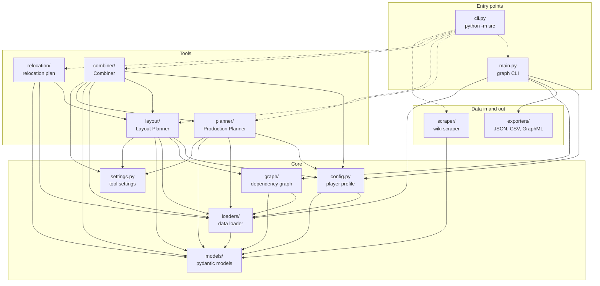
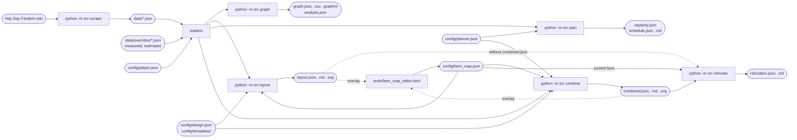

# Architecture

Two diagrams of the code base: which package imports which, and how data moves from the wiki to the output files. The rules behind them are in the [README](../README.md#architecture). GitHub renders the Mermaid blocks; elsewhere paste them into [mermaid.live](https://mermaid.live).

## Package dependencies

Each node is a package or module under `src/`. A solid arrow is a static import (`A --> B`: A imports B). A dotted arrow is the unified CLI starting a tool by name (`importlib`). `tests/test_architecture.py` fails when the solid arrows differ from the real imports, so update this diagram together with the code.

What to read from it:

- `layout` and `planner` have no arrow between them: they stay independent, only `combiner` joins them.
- Every arrow points down towards `models`; the core never imports a tool.
- `relocation` imports only the farm map model from `layout` (`layout/farm_map.py`) and reads the layout as a JSON file; it never imports `planner`.

## Data flow

From the wiki to the files a player reads. Rounded nodes are files, rectangles are commands.

- `python -m src all` runs graph, layout, plan and combine in this order; `relocate` is separate.
- The Combiner runs the Layout Planner and the Production Planner itself; it does not read their output files.
- Every generated file goes to `output/` (git-ignored).
