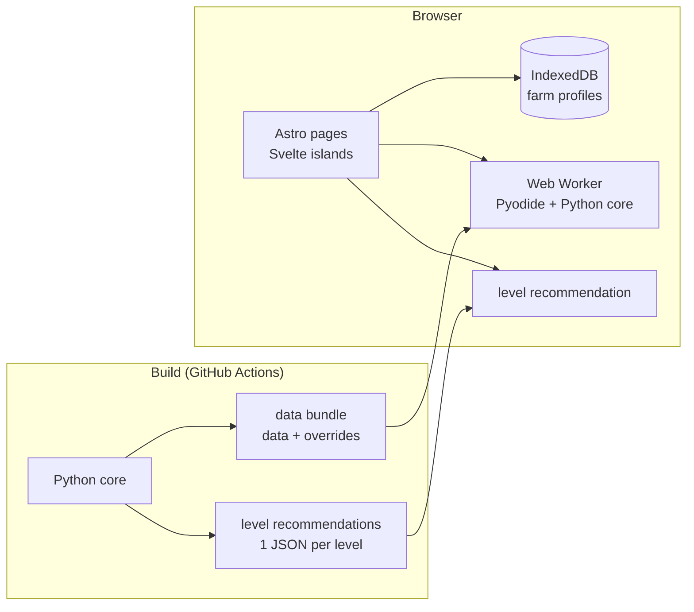

# v2 design

Target architecture of the web app (v2) and what v3 / v4 build on. The sub-versions and their done criteria are in [roadmap.md](roadmap.md); the domain terms (base map, profile map, farm profile, level recommendation, plot recommendation) in [CONTEXT.md](../CONTEXT.md).

## Goals

- v2: a free static web app for the maintainer's own use and testing; v3: public, no login; v4: optional login.
- Reuse the Python core unchanged: graph, Layout Planner, Production Planner, Combiner, relocation plan.
- Phone, tablet and desktop alike, as the game is played on phones and tablets; the interface rules are in `ui-design.md` from v2.5. English and Hungarian UI from v2.2 (game item names stay English).
- No server-side data in v2: everything stays in the browser, JSON export is the backup.
- The CLI stays the developer tool: tests, scrape, build-time precompute.

## Architecture

| Part                  | Choice                                                                                                                                                                                                                                                                                                 | Why                                                                                                    |
| --------------------- | ------------------------------------------------------------------------------------------------------------------------------------------------------------------------------------------------------------------------------------------------------------------------------------------------------ | ------------------------------------------------------------------------------------------------------ |
| Level recommendation  | precomputed at build time for levels 1-100, one static JSON per level, level defaults and default settings                                                                                                                                                                                             | instant, no runtime download; the CLI already makes level-default profiles (`src/planner/examples.py`) |
| Farm profile, "Check" | Pyodide in a module Web Worker, loaded lazily on the first own calculation                                                                                                                                                                                                                             | the core runs unchanged with byte-identical output; nothing leaves the browser                         |
| UI                    | Astro + TypeScript, Svelte islands                                                                                                                                                                                                                                                                     | static pages per level and legal pages; Svelte keeps the dynamic forms short                           |
| Visual design         | the pattern of the portfolio site [drntth.github.io](https://github.com/Drntth/drntth.github.io): Tailwind CSS v4, the same tokens and shared classes, header and footer, dark mode toggle, background glows; own palette (barn red, wheat yellow, sky → grass background) and fonts (Fredoka, Nunito) | one look across the owner's public sites, a game-like feel without copying the game's look             |
| Languages             | English at the root, Hungarian under `/hu/`, UI strings in `web/content/<lang>.json`; game item names stay English                                                                                                                                                                                     | the owner's audience is Hungarian too; item names have no Hungarian source yet                         |
| Editor rendering      | SVG + Pointer Events                                                                                                                                                                                                                                                                                   | the farm has a few hundred items; reuses `render_svg.py` geometry and the tested map editor core       |
| Storage               | IndexedDB (idb-keyval), `schema_version` in every stored JSON, tested migrations, JSON export / import, `navigator.storage.persist()`                                                                                                                                                                  | larger quota than localStorage, Blob support; Safari may evict, so export is the real backup           |
| Hosting               | GitHub Pages, deployed by GitHub Actions after green CI; Pyodide from the jsDelivr CDN                                                                                                                                                                                                                 | free; Pyodide does not count against the Pages limits                                                  |

Rejected: a Python backend (server, privacy, changing free tiers), a TypeScript rewrite of the core (two implementations to keep in sync), Python UI frameworks (stlite, PyScript: no free-drag editor), only precomputed results (no own profile, no "Check").

## Pyodide measurements

Own measurement in a throwaway browser spike (not in this repository; not reproducible from it): Pyodide 314.0.7 (Python 3.14.2), core v1.6.2, level-56 example profile, desktop browser, 2026-11-06. The v2.4 smoke test in CI replaces it with a repeatable check.

| Measure                    | Value                                                                                                                                                                                                                                                    |
| -------------------------- | -------------------------------------------------------------------------------------------------------------------------------------------------------------------------------------------------------------------------------------------------------- |
| Compatibility              | runs unchanged; the four result JSONs are byte-identical to native CPython                                                                                                                                                                               |
| First download (br / gzip) | ~26 MB, of which scipy ~13.9 MB (only for `linprog`)                                                                                                                                                                                                     |
| Desktop, cold              | Pyodide ready 1.4 s, packages 2.6 s, first `all` run 7.5 s                                                                                                                                                                                               |
| Desktop, warm              | `all` ~2 s, `combine` ("Check") ~0.9 s                                                                                                                                                                                                                   |
| Heap                       | 113 MB                                                                                                                                                                                                                                                   |
| Mobile                     | owner's phone, 2026-11-23 (Xiaomi Note 13 Pro, Brave 1.99.57 / Chromium 157, Wi-Fi, Pages): cold 23.2 s (load and plan together; the split came later), warm plan 4.6 s, after a reload 20.9 s (Pyodide starts again; the cache saves only the download) |

Repeatable check since v2.4: `node web/scripts/pyodide-smoke.mjs` (CI job `pyodide-smoke`, Node 24, npm `pyodide` 314.0.8, packages from the CDN) plans a level-30 farm profile and compares the JSON with native CPython. Local run, 2026-11-23: identical (82903 characters); native 0.7 s; Pyodide ready 1.2 s, packages 1.4 s, `core.zip` and data bundle 2.6 s, plan 0.5 s cold / 0.4 s warm; 6.8 s in all. In headless Chromium (Playwright) the first plan of the page, download included, took about 16 s.

Loading notes: only module workers work (`new Worker(url, { type: "module" })`); load networkx by its wheel URL, because its Pyodide lock entry pulls in matplotlib.

## Data model changes

### Base map and profile map

The v1 `config/farm_map.json` mixes shared geometry and one player's state. v2 splits it:

| File        | Holds                                                                    | Where                                                                                             |
| ----------- | ------------------------------------------------------------------------ | ------------------------------------------------------------------------------------------------- |
| Base map    | size, fixed items, plots, `buildable` and `blocked` zones; geometry only | committed in `data/`, shared by every farm profile; the screenshot and its calibration stay local |
| Profile map | unlocked plots, `design` zones, current farm (`current`)                 | per farm profile: IndexedDB in the web app, a local file for the CLI                              |

The CLI keeps reading the old one-file map through a migration, until the map editor writes both parts.

### Farm profile

One farm profile = player profile + profile map + design settings + planner settings. A new farm profile starts from the defaults. At least two farm profiles can be kept side by side, so several players can be simulated before v3 makes the app public.

### Versioned schemas

Every JSON the web app stores or exchanges has a `schema_version`: player profile, base map, profile map, design and planner settings, design template, results. Each version bump gets a migration function and a test.

## Core API

v2.0 adds entry points without file IO: dicts in, dicts out. The CLI and the Pyodide worker both call them, so the web app never touches the file system. The existing pure functions (`run_planner`, `plan_layout`, `combine`, `plan_relocation`; see [modules.md](modules.md)) become the base; loading and writing stay in the CLI modules. A data bundle (`data/*.json` merged with `data/overrides/`) is built once per release, so the browser loads one file.

## Plot recommendation

A new layout step: from the base map plots, pick the smallest connected set that fits the blocks of a level or farm profile and that can be unlocked in game order (from level 22, each plot next to an unlocked one; see [game-facts/farm.md](game-facts/farm.md)). Ties go to fewer plots, then to the lower unlock cost: the wiki lists the expansion supplies (and permits) per plot for every section except `special_2018` ([game-facts/farm.md](game-facts/farm.md)); v2.8 brings them into `data/` through the scraper, and a plot without a listed cost stays empty. The level recommendations use it once it exists; before that they are laid out on section `base` only.

## Site structure and farm view

The layout is the primary tool, the production plan the secondary one, so the site never shows them on one page (v2.3):

- Pages per level: `/levels/N/` the farm layout, `/levels/N/plan/` the production plan (same under `/hu/`); a switch between them. The layout page carries only a short plan summary (2-3 key figures) and a link.
- Farm view: an interactive SVG rendered in the page (one Svelte island) from the layout JSON, not the static `layouts/N.svg` image. Pan and zoom with Pointer Events; blocks are clickable; the area outside the buildable zones is faint or hidden. The same component later shows farm profiles (v2.6) and becomes the editor (v2.9).
- Block interactions: highlight one block and grey out the others (click on the block or its legend entry), zoom to a block, a detail panel (buildings, copies, fields), hover links between the block table and the map. Keyboard reachable.
- Plan page: short summary first, login actions grouped by building and collapsed by default (`
`).
- Login schedule: a planner setting for the daily active window and the number of logins replaces the round-the-clock hourly interval; the default is a few logins a day.
- From the portfolio site as well: reveal animations (off with `prefers-reduced-motion`), a card grid of the levels on the home page, a hamburger menu on small screens.

## Site design fixes

Decided for v2.2 after a review of the first design:

- Palette "summer farm": colours sampled from a farm screenshot (grass, terracotta road, teal water, sand) and the Hay Day wiki theme (leaf greens). Leaf green is the main colour, barn red the second, wheat, road and water extra tones. Light and dark use their own, slightly shifted values; text colours keep 4.5:1 on the surface.
- Name "Farm layout & production" (hu "Farmelrendezés és termelés"): it names both tools, the layout first, as the repository builds the graph for the layout. Own barn silhouette logo as SVG, also the favicon.
- Menu: Levels, How it works, Usage; the source link moves to the footer; a hamburger with a card grid on small screens. "How it works" and "Usage" are short pages, one screen each.
- Home: picker and button right of the title, full-width intro, a card grid of the levels instead of the table.
- Level page: page header with key figures and a compact level switch, a "next level" card at the end; layout first, then login actions, plan details and upcoming unlocks. Farm image at full width with block cards below; login actions as step cards per action type. Game and planner version as footer badges.
- Implemented with two deviations: the hamburger shows below 1024 px (the Hungarian name and three menu items do not fit at 768 px), and the block cards have no anchor yet, because the recommendation JSON does not carry it.
- v2.3 keeps the split into layout and plan pages, the interactive farm view, collapsed plan details, the login window setting and reveal animations.

## Testing

- pytest and ruff for the core, unchanged.
- Vitest for the TypeScript code: state, migrations, the map editor core as a module.
- Playwright end-to-end tests with a phone, a tablet and a desktop viewport, with no sideways scroll: load, farm profile, "Check", export / import.
- Pyodide smoke test as its own CI job (node + npm `pyodide`, needs the network): runs the core and compares the outputs with the native run, because the Pyodide package versions differ from the pinned ones.
- A web ↔ core boundary test in the spirit of `tests/test_architecture.py`: the web app calls only the Core API.

## Legal

- Every page shows the Supercell Fan Content Policy notice: "This material is unofficial and is not endorsed by Supercell. For more information see Supercell's Fan Content Policy: <https://supercell.com/en/fan-content-policy/>." (the same text and link as the README disclaimer)
- No game screenshots or game assets (pictures, icons, sounds); pictures of game objects are own drawings made for this site that only look similar (v2.5).
- No fees or paid features; no domain or account named after the game.
- Code is MIT; the game data in `data/` comes from the Hay Day Wiki and is CC BY-SA 3.0 with attribution, `data/overrides/` included (README and web app footer).
- v2 has no server-side data and no tracking. v3 / v4 need a privacy note for the sync.

## Later versions

- v3 sync between devices without login: JSON file / QR export first; a Cloudflare Worker + D1 with client-side encryption only if needed.
- v4 login and database: Supabase or Cloudflare D1, decided when v4 is planned.

## Decisions

| Date       | Decision                                                                                                                                                                                                                                                                                                                                                                                                          |
| ---------- | ----------------------------------------------------------------------------------------------------------------------------------------------------------------------------------------------------------------------------------------------------------------------------------------------------------------------------------------------------------------------------------------------------------------- |
| 2026-11-06 | Compute model: level recommendations precomputed at build time (levels 1-100) plus Pyodide in a Web Worker for farm profiles and "Check", already in v2                                                                                                                                                                                                                                                           |
| 2026-11-06 | Base map and profile map split in v2; `buildable` / `blocked` zones are base map, `design` zones are profile map                                                                                                                                                                                                                                                                                                  |
| 2026-11-06 | A farm profile holds its own design and planner settings                                                                                                                                                                                                                                                                                                                                                          |
| 2026-11-06 | Plot recommendation is a new layout feature of its own sub-version                                                                                                                                                                                                                                                                                                                                                |
| 2026-11-06 | v2 starts with scipy; scipy → `highspy` (~0.9 MB instead of ~13.9 MB) is a later, measured step                                                                                                                                                                                                                                                                                                                   |
| 2026-11-06 | UI: Astro + TypeScript with Svelte islands; editor: SVG + Pointer Events                                                                                                                                                                                                                                                                                                                                          |
| 2026-11-06 | The farm profile form is interactive and dynamic: the fields follow the level and start from the level defaults                                                                                                                                                                                                                                                                                                   |
| 2026-11-06 | The site design follows the portfolio site drntth.github.io (or stays very close to it); what exactly is taken over is planned first                                                                                                                                                                                                                                                                              |
| 2026-11-06 | Design plan: the portfolio stack and pattern with a barn red / wheat yellow palette on a sky → grass background and Fredoka + Nunito; links to the portfolio site in the footer                                                                                                                                                                                                                                   |
| 2026-11-06 | Two languages (en, hu) move from v3.0 to v2.2; farm profiles and the later sub-versions shift by one (v2.3-v2.8)                                                                                                                                                                                                                                                                                                  |
| 2026-11-06 | New v2.3 (site structure and farm view): layout and plan on separate pages per level, interactive SVG farm view with block highlight / zoom / detail panel, realistic login schedule set by the player; the later sub-versions shift by one (v2.4-v2.9)                                                                                                                                                           |
| 2026-11-06 | v2.2 reopened for design fixes: summer farm palette, name "Farm layout & production", barn logo, menu (Levels, How it works, Usage), card grids, level page header; card grid and hamburger move from v2.3                                                                                                                                                                                                        |
| 2026-11-09 | v2.3 login schedule: `production.login_window` (`start`, `end`, `logins`; `null` = suggested) replaces `login_interval`; planner config schema bump with a migration; the plan uses the exact daily gaps                                                                                                                                                                                                          |
| 2026-11-09 | v2.3 farm view: own pan / zoom code with Pointer Events (no dependency); the buildable area comes from one map file written by `recommend`                                                                                                                                                                                                                                                                        |
| 2026-11-23 | New v2.5 (UI/UX design): interface rules researched and kept in `docs/ui-design.md` (input types, validation, icons, text density, accessibility, phone / tablet / desktop checks); the later sub-versions shift by one (v2.6-v2.10)                                                                                                                                                                              |
| 2026-11-23 | Pictures of buildings, animals, trees, bushes and goods (v2.5): own SVG drawings that look like the in-game objects so the player recognises them; never a game screenshot or asset: the player finds the right object at a glance; the Fan Content Policy does not allow game assets to be passed off                                                                                                            |
| 2026-11-23 | Automated checks replace the owner's manual phone check: Playwright with large text, a Hungarian-text check, a throttled mobile timing test (`npm run test:perf`) and live-site tests after each Pages deploy (`npm run test:live`); a real phone only for what no test covers: the owner should not have to test every release by hand; emulated Chromium is not every phone browser, so the risk stays recorded |
| 2026-11-23 | v2.5 is one release (v2.5.0) in four parts: (a) research and `docs/ui-design.md`, (b) form and profile check, (c) concept icons and item drawings, (d) pages, Usage, export reminder, accessibility; (a) is finished and approved before any code: the rules bind the three later parts; the sub-version numbers stay as they are                                                                                 |
| 2026-11-23 | Invalid values are never stored and never clamped: a short message at the field after leaving it, a summary with links at the top, Calculate disabled; one profile check for the form, the import (an invalid file is refused with its wrong fields) and a stored profile (loaded, marked): a clamp would silently change what the player typed                                                                   |
| 2026-11-23 | Game item names stay English on every page; every other text of the site is in both languages: the game has no Hungarian language, so a Hungarian name would not match what the player sees in the game                                                                                                                                                                                                           |
| 2026-11-23 | Export reminder: the last export is shown on every farm profile; a notice when the profile changed since then and that export is older than 7 days or missing; the export date is kept beside the profile in IndexedDB, not in the file: Safari may delete script-written storage after 7 days without a visit, and only a file survives a browser change                                                         |
| 2026-11-23 | `@axe-core/playwright` as a dev dependency (exact version): WCAG 2.2 A / AA rules on every page, phone and desktop, both languages and themes; touch targets and reduced motion by own tests: an automated check replaces a manual accessibility review                                                                                                                                                           |
| 2026-11-23 | Input rules: a dropdown for 5-10 valid values (copies, slots), a button row for 2-4 (mastery stars, beehives), otherwise a whole number with a range (level, barn and silo in steps of 25, fields, animals, fishing spots, logins per day); details in `ui-design.md`: Baymard finds dropdowns a poor choice under 5 or over 10 options                                                                           |
