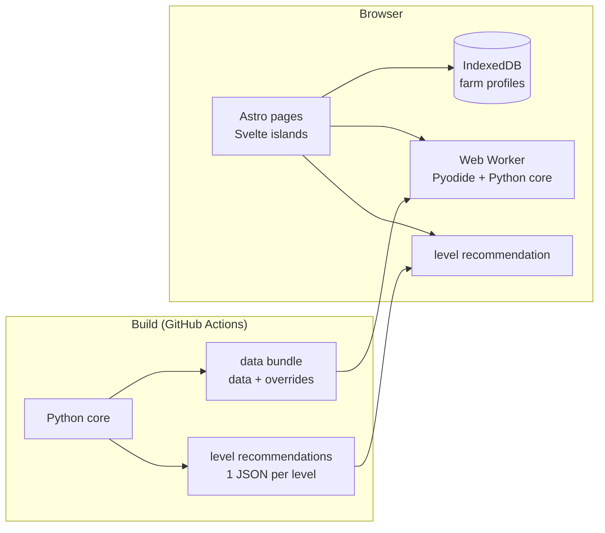

# v2 design

Target architecture of the web app (v2) and what v3 / v4 build on. The sub-versions and their done criteria are in [roadmap.md](roadmap.md); the domain terms (base map, profile map, farm profile, level recommendation, plot recommendation) in [CONTEXT.md](../CONTEXT.md).

## Goals

- v2: a free static web app for the maintainer's own use and testing; v3: public, no login; v4: optional login.
- Reuse the Python core unchanged: graph, Layout Planner, Production Planner, Combiner, relocation plan.
- Mobile and desktop alike; English UI, ready for i18n (Hungarian in v3).
- No server-side data in v2: everything stays in the browser, JSON export is the backup.
- The CLI stays the developer tool: tests, scrape, build-time precompute.

## Architecture

| Part                  | Choice                                                                                                                                                                            | Why                                                                                                    |
| --------------------- | --------------------------------------------------------------------------------------------------------------------------------------------------------------------------------- | ------------------------------------------------------------------------------------------------------ |
| Level recommendation  | precomputed at build time for levels 1-100, one static JSON per level, level defaults and default settings                                                                        | instant, no runtime download; the CLI already makes level-default profiles (`src/planner/examples.py`) |
| Farm profile, "Check" | Pyodide in a module Web Worker, loaded lazily on the first own calculation                                                                                                        | the core runs unchanged with byte-identical output; nothing leaves the browser                         |
| UI                    | Astro + TypeScript, Svelte islands                                                                                                                                                | static pages per level and legal pages; Svelte keeps the dynamic forms short                           |
| Visual design         | follows the design of the portfolio site [drntth.github.io](https://github.com/Drntth/drntth.github.io), or stays very close to it; the details are planned before they are built | one look across the owner's public sites; the v2.1 styling is a plain placeholder                      |
| Editor rendering      | SVG + Pointer Events                                                                                                                                                              | the farm has a few hundred items; reuses `render_svg.py` geometry and the tested map editor core       |
| Storage               | IndexedDB (idb-keyval), `schema_version` in every stored JSON, tested migrations, JSON export / import, `navigator.storage.persist()`                                             | larger quota than localStorage, Blob support; Safari may evict, so export is the real backup           |
| Hosting               | GitHub Pages, deployed by GitHub Actions after green CI; Pyodide from the jsDelivr CDN                                                                                            | free; Pyodide does not count against the Pages limits                                                  |

Rejected: a Python backend (server, privacy, changing free tiers), a TypeScript rewrite of the core (two implementations to keep in sync), Python UI frameworks (stlite, PyScript: no free-drag editor), only precomputed results (no own profile, no "Check").

## Pyodide measurements

Own measurement in a throwaway browser spike (not in this repository; not reproducible from it): Pyodide 314.0.7 (Python 3.14.2), core v1.6.2, level-56 example profile, desktop browser, 2026-11-06. The v2.2 smoke test in CI replaces it with a repeatable check.

| Measure                    | Value                                                                      |
| -------------------------- | -------------------------------------------------------------------------- |
| Compatibility              | runs unchanged; the four result JSONs are byte-identical to native CPython |
| First download (br / gzip) | ~26 MB, of which scipy ~13.9 MB (only for `linprog`)                       |
| Desktop, cold              | Pyodide ready 1.4 s, packages 2.6 s, first `all` run 7.5 s                 |
| Desktop, warm              | `all` ~2 s, `combine` ("Check") ~0.9 s                                     |
| Heap                       | 113 MB                                                                     |
| Mobile                     | not measured yet; planned for v2.2                                         |

Loading notes: only module workers work (`new Worker(url, { type: "module" })`); load networkx by its wheel URL, because its Pyodide lock entry pulls in matplotlib.

## Data model changes

### Base map and profile map

The v1 `config/farm_map.json` mixes shared geometry and one player's state. v2 splits it:

| File        | Holds                                                                    | Where                                                                                             |
| ----------- | ------------------------------------------------------------------------ | ------------------------------------------------------------------------------------------------- |
| Base map    | size, fixed items, plots, `buildable` and `blocked` zones; geometry only | committed in `data/`, shared by every farm profile; the screenshot and its calibration stay local |
| Profile map | unlocked plots, `design` zones, current farm (`current`)                 | per farm profile: IndexedDB in the web app, a local file for the CLI                              |

The CLI keeps reading the old one-file map through a migration, until the map editor writes both parts.

### Farm profile

One farm profile = player profile + profile map + design settings + planner settings. A new farm profile starts from the defaults. At least two farm profiles can be kept side by side, so several players can be simulated before v3 makes the app public.

### Versioned schemas

Every JSON the web app stores or exchanges has a `schema_version`: player profile, base map, profile map, design and planner settings, design template, results. Each version bump gets a migration function and a test.

## Core API

v2.0 adds entry points without file IO: dicts in, dicts out. The CLI and the Pyodide worker both call them, so the web app never touches the file system. The existing pure functions (`run_planner`, `plan_layout`, `combine`, `plan_relocation`; see [modules.md](modules.md)) become the base; loading and writing stay in the CLI modules. A data bundle (`data/*.json` merged with `data/overrides/`) is built once per release, so the browser loads one file.

## Plot recommendation

A new layout step: from the base map plots, pick the smallest connected set that fits the blocks of a level or farm profile and that can be unlocked in game order (from level 22, each plot next to an unlocked one; see [game-facts/farm.md](game-facts/farm.md)). Ties go to fewer plots, then to the lower unlock cost: the wiki lists the expansion supplies (and permits) per plot for every section except `special_2018` ([game-facts/farm.md](game-facts/farm.md)); v2.5 brings them into `data/` through the scraper, and a plot without a listed cost stays empty. The level recommendations use it once it exists; before that they are laid out on section `base` only.

## Testing

- pytest and ruff for the core, unchanged.
- Vitest for the TypeScript code: state, migrations, the map editor core as a module.
- Playwright end-to-end tests with a mobile and a desktop viewport: load, farm profile, "Check", export / import.
- Pyodide smoke test as its own CI job (node + npm `pyodide`, needs the network): runs the core and compares the outputs with the native run, because the Pyodide package versions differ from the pinned ones.
- A web ↔ core boundary test in the spirit of `tests/test_architecture.py`: the web app calls only the Core API.

## Legal

- Every page shows the Supercell Fan Content Policy notice: "This material is unofficial and is not endorsed by Supercell. For more information see Supercell's Fan Content Policy: <https://supercell.com/en/fan-content-policy/>." (the same text and link as the README disclaimer)
- No fees or paid features; no domain or account named after the game.
- Code is MIT; the game data in `data/` comes from the Hay Day Wiki and is CC BY-SA 3.0 with attribution, `data/overrides/` included (README and web app footer).
- v2 has no server-side data and no tracking. v3 / v4 need a privacy note for the sync.

## Later versions

- v3 sync between devices without login: JSON file / QR export first; a Cloudflare Worker + D1 with client-side encryption only if needed.
- v4 login and database: Supabase or Cloudflare D1, decided when v4 is planned.

## Decisions

| Date       | Decision                                                                                                                                                |
| ---------- | ------------------------------------------------------------------------------------------------------------------------------------------------------- |
| 2026-11-06 | Compute model: level recommendations precomputed at build time (levels 1-100) plus Pyodide in a Web Worker for farm profiles and "Check", already in v2 |
| 2026-11-06 | Base map and profile map split in v2; `buildable` / `blocked` zones are base map, `design` zones are profile map                                        |
| 2026-11-06 | A farm profile holds its own design and planner settings                                                                                                |
| 2026-11-06 | Plot recommendation is a new layout feature of its own sub-version                                                                                      |
| 2026-11-06 | v2 starts with scipy; scipy → `highspy` (~0.9 MB instead of ~13.9 MB) is a later, measured step                                                         |
| 2026-11-06 | UI: Astro + TypeScript with Svelte islands; editor: SVG + Pointer Events                                                                                |
| 2026-11-06 | The farm profile form is interactive and dynamic: the fields follow the level and start from the level defaults                                         |
| 2026-11-06 | The site design follows the portfolio site drntth.github.io (or stays very close to it); what exactly is taken over is planned first                    |
